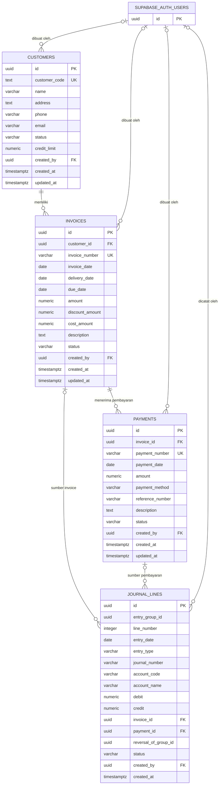

# PiutangGuard

PiutangGuard adalah aplikasi web internal untuk mengelola piutang usaha dan mencatat dampaknya ke jurnal. Aplikasi menyediakan data pelanggan, invoice, pembayaran, analisis umur piutang (aging), estimasi cadangan kerugian kredit (ECL), jurnal, serta laporan laba rugi dan posisi keuangan.

Frontend berupa HTML, CSS, dan JavaScript tanpa proses build. Autentikasi dan penyimpanan data menggunakan Supabase Auth dan PostgreSQL. Aturan transaksi, perhitungan, jurnal otomatis, serta Row Level Security (RLS) didefinisikan di [backend/schema.sql](./backend/schema.sql).

## Fitur

- Dashboard untuk ikhtisar piutang dan risiko.
- Pengelolaan pelanggan beserta status dan batas kredit.
- Invoice draft; pendapatan baru diakui saat invoice diposting setelah barang/jasa diserahkan.
- Pencatatan pembayaran sebagian maupun penuh terhadap satu invoice.
- Aging piutang per tanggal laporan.
- Estimasi dan posting penyesuaian ECL berdasarkan kelompok umur piutang.
- Jurnal pembukaan, jurnal otomatis, dan reversal yang tetap menyimpan jurnal asal.
- Laporan laba rugi dan posisi keuangan yang bersumber dari jurnal.
- Login Supabase; akses tabel dibatasi melalui RLS.

## Teknologi

- HTML, CSS, dan JavaScript di browser
- Supabase Auth, Supabase JavaScript SDK v2, dan PostgreSQL
- SQL: tabel, view, fungsi transaksi, trigger, constraint, dan RLS
- Font Awesome dan Google Fonts untuk elemen antarmuka

## Struktur proyek

```text
PiutangGuard/
├── backend/
│   ├── app.js          # Konfigurasi Supabase yang digunakan browser
│   └── schema.sql      # Skema, aturan transaksi, view, fungsi, dan kebijakan RLS
├── frontend/
│   ├── index.html      # Kerangka halaman dan dialog aplikasi
│   ├── script.js       # Navigasi, tampilan, dan integrasi Supabase
│   └── style.css       # Gaya antarmuka
├── index.html          # Mengarahkan pengunjung ke frontend aplikasi
└── README.md
```

## ERD



`SUPABASE_AUTH_USERS` menggambarkan `auth.users` milik Supabase, bukan tabel yang dibuat oleh `schema.sql`. Relasi `created_by` bersifat opsional. `entry_group_id` mengelompokkan beberapa baris sebagai satu jurnal; tidak ada tabel header jurnal terpisah. Nomor jurnal dan metadata jurnal yang sama disimpan pada setiap baris dalam kelompoknya. `reversal_of_group_id` menghubungkan baris jurnal reversal ke kelompok jurnal asal.

### Penjelasan relasi

1. **Pelanggan ke invoice — satu ke banyak.** Setiap invoice wajib merujuk ke satu pelanggan. Pelanggan dapat memiliki banyak invoice. Penghapusan pelanggan yang masih direferensikan dicegah (`ON DELETE RESTRICT`).
2. **Invoice ke pembayaran — satu ke banyak.** Setiap pembayaran terkait ke satu invoice, sementara invoice dapat dibayar melalui beberapa pembayaran, termasuk pembayaran parsial. Invoice yang dirujuk tidak dapat dihapus.
3. **Invoice/pembayaran ke baris jurnal — satu ke banyak secara konseptual.** Posting invoice atau pembayaran menghasilkan beberapa baris debit/kredit. Kedua foreign key pada `journal_lines` boleh kosong, misalnya untuk jurnal pembukaan dan ECL; sebuah baris sumber transaksi tidak dapat sekaligus menunjuk invoice dan pembayaran, kecuali pada tipe `PAYMENT` atau `REVERSAL`.
4. **Jurnal terdiri dari baris.** Baris dengan `entry_group_id` yang sama membentuk satu kelompok jurnal. Constraint database memastikan kelompok memiliki setidaknya dua baris, debit sama dengan kredit, serta metadata kelompok konsisten.
5. **Reversal menjaga jejak audit.** Jurnal yang telah diposting tidak dapat diedit atau dihapus. Koreksi dilakukan dengan membuat jurnal baru yang membalik debit dan kredit, dan mengisi `reversal_of_group_id` dengan ID kelompok asal.

## Kamus data

Skema inti terdiri dari empat tabel operasional:

### `customers`

Menyimpan identitas pelanggan dan kontrol kredit: `customer_code` unik, nama, informasi kontak, `status` (`ACTIVE` atau `INACTIVE`), dan `credit_limit`. Pelanggan aktif harus memiliki batas kredit positif. Kolom `created_by` merujuk ke pengguna Supabase yang membuat data.

### `invoices`

Menyimpan transaksi tagihan untuk pelanggan melalui `customer_id`. `amount` adalah nilai bruto, sedangkan nilai piutang bersih dihitung sebagai `amount - discount_amount`. `cost_amount` menyimpan harga pokok transaksi. Tanggal penyerahan (`delivery_date`) digunakan untuk validasi pengakuan pendapatan.

Status invoice: `DRAFT`, `UNPAID`, `PARTIALLY_PAID`, `PAID`, atau `REVERSED`. Nomor invoice unik. Tanggal jatuh tempo tidak boleh mendahului tanggal invoice atau tanggal penyerahan (jika diisi).

### `payments`

Menyimpan pembayaran atas satu invoice melalui `invoice_id`, termasuk tanggal, jumlah, metode pembayaran, nomor referensi, dan deskripsi. Nomor pembayaran unik. Jumlah harus positif dan tidak boleh melampaui sisa piutang saat diposting.

Status pembayaran: `DRAFT`, `POSTED`, atau `REVERSED`. Pembayaran draft dapat dikelola pengguna; posting memperbarui status invoice dan membuat jurnal.

### `journal_lines`

Menyimpan baris debit/kredit jurnal, bukan header jurnal. `entry_group_id` mengelompokkan baris; `line_number` mengurutkan baris dalam kelompok. `journal_number` adalah nomor bukti yang dibagikan oleh seluruh baris dalam satu kelompok.

`entry_type` menunjukkan sumber atau tujuan jurnal, seperti `OPENING`, `INVOICE`, `PAYMENT`, `ECL`, dan `REVERSAL`. Setiap baris harus berisi nilai positif hanya pada salah satu sisi (`debit` atau `credit`), dan statusnya selalu `POSTED`. Baris jurnal hanya dapat dibaca langsung oleh pengguna aplikasi; pembuatan jurnal dilakukan melalui fungsi database.

### View dan fungsi laporan

- `v_aging_schedule` menyajikan aging piutang untuk tanggal berjalan.
- `get_aging_schedule(p_as_of_date)` menghitung aging pada tanggal laporan yang dipilih, total pembayaran terposting, saldo piutang, hari keterlambatan, serta kelompok umur: belum jatuh tempo, 1–30, 31–60, 61–90, dan lebih dari 90 hari.
- `calculate_ecl(p_as_of_date, p_rates)` menghitung estimasi kerugian kredit per invoice dan kelompok umur. Tarif awal bersifat asumsi ilustratif dan dapat disesuaikan.
- `v_account_balances` merangkum total debit, kredit, dan saldo per akun dari baris jurnal terposting.
- Laporan laba rugi dan posisi keuangan di antarmuka mengambil data dari jurnal dan saldo akun.

## Alur transaksi dan posting

1. Pengguna membuat data pelanggan dan invoice berstatus draft.
2. Saat invoice diposting, database memvalidasi pelanggan aktif, tanggal penyerahan, nilai diskon, serta batas kredit. Posting mengubah status invoice dan membuat jurnal piutang usaha serta pendapatan penjualan; harga pokok dan persediaan ikut dicatat jika `cost_amount` lebih dari nol.
3. Pengguna mencatat satu atau lebih pembayaran draft pada invoice. Saat pembayaran diposting, database memastikan jumlahnya tidak melebihi saldo, mengubah status pembayaran dan status invoice, lalu membuat jurnal kas/bank dan piutang usaha.
4. Aging menghitung saldo invoice dengan memperhitungkan pembayaran yang telah diposting sampai tanggal laporan. Estimasi ECL menggunakan saldo dan kelompok umur tersebut; posting ECL membuat jurnal penyesuaian atau pembalikan cadangan.
5. Jurnal pembukaan dikirim ke fungsi database dalam bentuk daftar baris dan hanya diposting jika minimal dua baris serta total debit sama dengan total kredit.
6. Jurnal yang perlu dikoreksi dibalik melalui fungsi reversal. Jurnal asli tetap disimpan untuk audit.

Posting transaksi memakai fungsi PostgreSQL (`post_invoice`, `post_payment`, `post_ecl_adjustment`, `post_opening_journal`, dan `reverse_journal`) agar perubahan status serta jurnal terkait dilakukan dalam satu transaksi database.

## Menjalankan aplikasi

### 1. Siapkan Supabase

1. Buat proyek Supabase.
2. Buka **SQL Editor**, lalu jalankan seluruh isi `backend/schema.sql`. Skema ini membuat atau memperbarui empat tabel operasional, view, fungsi, trigger, constraint, serta kebijakan dan hak akses RLS.
3. Buat akun pengguna melalui Supabase Auth untuk pengguna internal. Skema mengasumsikan workspace satu perusahaan: pengguna yang sudah diautentikasi berbagi akses ke catatan perusahaan yang sama.
4. Nonaktifkan pendaftaran publik (sign-up) pada konfigurasi Supabase Auth dan buat akun hanya untuk pengguna yang diizinkan.
5. Periksa dan sesuaikan kebijakan RLS serta tarif ECL dengan kebijakan keamanan dan akuntansi organisasi sebelum digunakan dengan data produksi.

### 2. Atur koneksi

Konfigurasi browser berada di `backend/app.js`. Pastikan URL proyek dan **publishable key** Supabase sudah benar. Publishable key memang dapat terlihat di browser; perlindungan data harus tetap mengandalkan RLS. Jangan pernah menaruh `service_role` key atau kredensial rahasia pada file frontend atau repository.

### 3. Jalankan di komputer sendiri

Jalankan server HTTP dari folder utama proyek (folder yang berisi `index.html` dan folder `backend`):

```powershell
py -m http.server 8000
```

Buka `http://localhost:8000` di browser. Halaman utama akan mengarahkan ke frontend. Jangan jalankan server hanya dari folder `frontend`, karena aplikasi juga memuat konfigurasi dari `backend/app.js`.

### 4. Terbitkan aplikasi dengan GitHub Pages

URL repositori GitHub hanya menampilkan kode dan README; untuk membuka aplikasi, gunakan URL GitHub Pages.

1. Unggah seluruh isi proyek ke repositori GitHub, termasuk `index.html`, `frontend/`, dan `backend/`.
2. Pada repositori, buka **Settings → Pages**.
3. Di bagian **Build and deployment**, pilih **Deploy from a branch**, lalu pilih branch utama (misalnya `main`) dan folder **/(root)**. Klik **Save**.
4. Tunggu proses deployment selesai. Buka URL yang ditampilkan di halaman **Settings → Pages**. `index.html` di root akan meneruskan ke aplikasi.
5. Di Supabase, tambahkan domain GitHub Pages tersebut pada konfigurasi **Auth → URL Configuration** (Site URL dan Redirect URLs) bila diperlukan.

GitHub Pages hanya menyajikan file frontend statis; database, autentikasi, dan fungsi aplikasi tetap dijalankan oleh Supabase. Pastikan skema `backend/schema.sql` sudah dijalankan dan konfigurasi pada `backend/app.js` menggunakan URL serta publishable key proyek Supabase yang benar. Browser perlu akses internet untuk memuat Supabase SDK dan ikon dari CDN.

## Keamanan dan batasan

- Tabel operasional dilindungi RLS. Akses hanya diberikan kepada peran `authenticated`; tabel inti tidak tersedia untuk `anon`.
- Ini adalah workspace satu perusahaan dengan akses bersama untuk pengguna terautentikasi, bukan pemisahan data per pengguna atau per tenant.
- Invoice dan pembayaran hanya dapat diubah atau dihapus selama berstatus draft melalui kebijakan yang tersedia.
- Baris jurnal tidak dapat dimutasi langsung; posting dan reversal dilakukan lewat fungsi database.
- Tarif ECL bawaan adalah asumsi ilustratif, bukan rekomendasi akuntansi. Verifikasi tarif, akun, dan perlakuan akuntansi dengan pihak yang berwenang.

## Catatan skema

`backend/schema.sql` menggunakan transaksi dan perintah upgrade in-place (`ADD COLUMN IF NOT EXISTS`) untuk menjaga data saat skema lama diperbarui. Jalankan skrip sebagai administrator proyek Supabase, tinjau perubahan sebelum menjalankannya pada database produksi, dan simpan backup database sesuai prosedur organisasi.
